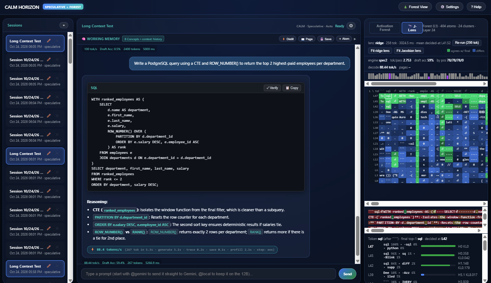

# calm-horizon-research

A local language model you can read, steer and extend
CALM Horizon runs an open-weight model on one consumer GPU with its internals on display: which concepts were active, when each word was decided, what knowledge was loaded and why, and what the safety monitors saw.

CALM Horizon is a research tool that ensures safety and ethical responses as they are created. Because this adds additional load, implementing safety can reduce efficiency and increase cost. The CALM in CALM Horizon is Chunked Attention Language Model where up to four tokens are generated in a single neural network forward pass instead of the usual one at a time with standard Autoregression. CALM pays for that additional load, and CALM Horizon is actually faster than llama.cpp, the gold standard for local inference.

CALM Horizon does much more. It destroys the myth that we cannot understand what is happennning inside the AI and steer it towards desirable responses. It implements Virtual Knowledge Domains that graft knowledge only when needed giving small fast backbones more intelligence without vast amounts of high bandwidth memory. It implements a hazard probe and the Artificial Moral Agent to govern responses while they are being created.

What it is
Four ideas
Speed
Deep dives
Results so far
Models
88.6 tok/s
Workbench decode speed with every safety and interpretability feature live
Gemma 4 12B, RTX 3090 Ti
85.6 tok/s
Ollama on the same quantized weights
llama.cpp Q4_0 grid
0
extra forward passes for the safety monitors
they read the pass that wrote the tokens
5
research papers drafted, including the negative results
see Research
What CALM Horizon is
CALM Horizon is a research workbench that runs an open-weight language model on one consumer GPU and makes it readable, steerable and extendable while it talks. It is not a new model. It wraps a model you already have (today Google's Gemma 4 12B) in instruments that watch its internal state during every step of generation.

The design rests on one idea: read the model's internal activations as a small set of human-labelled concepts, and use that same reading for everything else. The atoms that explain an answer also decide which knowledge to load, feed the safety monitors, and show up in the visual Activation Forest.

Your message
Context builder
history and memory
J-Lens
reads every layer
Answer stream
Decoder model
e.g. Gemma 4 12B, 48 layers
one forward pass per step
tap
Sparse dictionary
a few active atoms
per token (SAE)
Knowledge pages
router
Activation Forest
what was active
Hazard probe
allow · ablate · refuse
AMA monitor
moral-drift check
residuals, no SAE needed
loads a page into the model
CALM ⚡ decode loop
draft → verify → commit · output stays exact
steer · clamp
· stop
How the parts connect. One forward pass of the model produces each step. Its residual at one layer is tapped and decomposed by a sparse dictionary; the Forest, the page router and the hazard probe all read those atoms. The AMA monitor reads the raw residuals, and the J-Lens reads every layer. The monitors act inside the decode loop, so no output path can bypass them.
Four ideas
Read the residual stream as concepts
A sparse autoencoder (SAE) rewrites one layer's activations as a few active "atoms" per token, each with a label and an exact list of words it pushes up or down.

Address knowledge by concept
Domain "pages" load when the conversation calls for them, with the reason stated in words. The base model's weights are never changed.

Decode fast, but exactly
Speculative decoding drafts several tokens and checks them in one pass. The output distribution is provably the same as plain one-token-at-a-time decoding.

Put safety in the mechanism
A hazard probe and a moral-drift (AMA) monitor score the model's own activations during decoding and can steer, clamp or stop, and every stop explains itself.

As fast as Ollama, with the instruments on
Instrumentation usually costs speed, because it needs hooks into the model that fast runtimes don't offer. CALM Horizon built its own runtime (CUDA graphs, custom kernels, the model's own draft head) so the monitors and tracer ride along at full speed.

Decode speed, Gemma 4 12B on an RTX 3090 Ti

tokens per second, higher is better

CALM Horizon
Ollama
0
25
50
75
100
Ollama (same QAT weights)
85.6
CALM Workbench, all features on
88.6
CALM engine, benchmark
92.7
Decode tokens per second on the same machine and the same quantized Gemma 4 12B weights. Workbench figure includes safety monitors, atom tracing and the thinking channel; the benchmark figure is the engine alone on short prompts. Long prompts (8,000 tokens) are slower: 68.5 tok/s.
Show data table
Deep dives
CALM decoding engine
Speculative decoding that stays exact; the CUDA graph engine; how the 12B beats Ollama.

Read more →
DSAE and anti-drift
The denoising dictionary, drift envelopes, loop guards, and the one anti-drift idea we retired.

Read more →
Virtual Knowledge Domains
Paged knowledge: value sets keyed by atoms and LoRA pages chosen by a per-page classifier.

Read more →
Hazard probe and AMA
Two monitors that read activations, three response bands, calibration and explained stops.

Read more →
Interpretability
Sparse dictionaries, vocabulary fingerprints, and what our measurements say about reading features.

Read more →
The J-Lens
Layer-by-layer read-outs: when did the model settle on each token?

Read more →
Activation Forest
How to read the canopy, steer an atom, and test whether a concept caused the output.

Read more →
Token-based context management
History budgets, gist and anchors, KV ring buffers, and why context content matters.

Read more →
Research papers
Five drafts, their state, and the rules every number follows.

Read more →
What we have learned so far
The project publishes its failures alongside its successes. Every number on this site comes from a stored result file, and several early headline results were withdrawn when we found faults in how they were measured. One of the five papers is a catalogue of those faults.

Question	Result	State
Can a fully instrumented local model match a production runtime?	88.6 vs 85.6 tok/s (Workbench vs Ollama, same weights)	Measured
Does activation size tell you which features matter?	No: rank correlation −0.08; the causal core is mostly not among the loudest	Measured Paper 1
Does switching off a concept's features remove the concept?	Only partly: about 40–50% at best for one feature	Judge calibration pending Paper 2
Do atom-keyed knowledge pages help only their domain?	Mechanically yes; under the stricter amended placebo test no domain passes	Mostly negative Paper 4
Can draft heads beat the 'chunk floor'?	1.30× speed-up across 28 prompts on the 1B model	Measured Paper 5
Does the hazard probe detect hazard rather than phrasing?	Not shown yet: a 3-word baseline separates the benchmark	Not claimed
!
Research prototype
CALM Horizon runs on Windows without Docker on a single workstation (Intel i9-13900K, 32 GB RAM, RTX 3090 Ti 24 GB). It is not a hosted service. The open-source release is planned for the Gemma 4 E4B version, which targets a home-robot brain with Virtual Knowledge Domains.

Models it runs
Model	Weights	VRAM	Dictionary layer	Notes
Gemma 4 12B (default)	QAT 4-bit, exact Q4_0 grid	~8 GB	24 of 48	MTP draft head; fastest path
Gemma 4 12B	8-bit	~13 GB	24	
Qwen3.6-27B	4-bit	~16 GB	31	Hybrid attention: exact plain decoding only
Gemma 3 1B (research line, frozen)	bf16 + grafted draft heads	~2.5 GB	13	Where most of the measurements were made
